# Local Document Knowledge Lab

A local document assistant and RAG experimentation workbench. Upload documents, inspect their
chunks, compare retrieval pipelines, and connect an OpenAI-compatible API or installed Ollama model
when you are ready. The API URL, key, and model names can be supplied later through `.env`.
This implements project 2 in the [portfolio roadmap](../AI_PROJECT_ROADMAP.md), with the requested
expansion to multiple vector stores and retrieval methods.

**Build first, model experiments later.** The default is SQLite + deterministic hash vectors +
evidence-only responses. The app contains no model download or pull operation. Startup does not
contact inference APIs or the optional databases. Hash vectors compare words; they are **not semantic
embeddings**, and evidence mode returns quoted passages, **not an AI-generated answer**.

## What is implemented

| Area | Options |
| --- | --- |
| Interface | Streamlit: Ask & inspect, Documents, Index studio, Compare, Evaluations, Runs & reviews |
| Sources | UTF-8 Markdown/text; text-based PDF through the optional `pdf` extra |
| Chunking | Fixed character windows, sentence boundaries, Markdown sections, optional LangChain recursive splitter |
| Embeddings | Deterministic local hash baseline; Ollama; OpenAI-compatible `/embeddings` |
| Vector storage | SQLite/NumPy reference implementation, PostgreSQL + pgvector, Chroma, Qdrant, FAISS |
| Retrieval | BM25, vector similarity, weighted reciprocal rank fusion, maximum marginal relevance (MMR) |
| Controls | Chunk size/overlap, top k, candidate pool, score thresholds, hybrid weights, MMR diversity, document filters |
| Extra retrieval experiments | Fixed dictionary query expansion; lexical overlap reranking |
| Answers | Evidence notebook; streamed OpenAI-compatible or Ollama generation with citation checks |
| Experiments | Independent index snapshots, two-column comparisons, persistent traces, JSON exports, human reviews |
| Evaluation | 40 fixed questions; passage recall, MRR, nDCG, hit rate, latency, and unsupported-query empty-result rate |

pgvector, Chroma, and Qdrant are vector databases. FAISS is a vector search library; SQLite/NumPy
is an exact-search reference implementation. Their adapters use explicit vectors and never
invoke a backend's default embedding function. Optional adapters are real implementations,
but live integration verification is deferred; see [verification status](reports/VERIFICATION.md).

## Run now without downloading anything

This workspace already has the required core packages in the first project's environment.
From this directory:

```bash
../support-transcript-summarizer/.venv/bin/python scripts/dev.py
```

Open **http://127.0.0.1:8502**. API reference: **http://127.0.0.1:8020/docs**.
The ports are separate from the transcript summarizer. Ctrl-C stops the API and UI.
The launcher starts no model or database services and performs no installation.

1. **Documents → Load demo policies**, or upload your own `.md`/`.txt` files.
2. **Index studio → Build snapshot** with SQLite, hash embeddings, and Markdown chunking.
3. Refresh the build status until it is ready.
4. **Ask & inspect → Inspect retrieval** to inspect matches and component scores.
5. **Ask with evidence** returns verbatim passages with source links.
6. In **Compare**, select the same index on both sides and compare BM25 with hybrid or MMR.

The bundled policies are fictional demonstration data. They are not banking advice or real
service rules. Source text and model output render as plain text to avoid executing embedded
markup or loading remote images.

## Independent setup, when ready

Use Python 3.11+; the current code checks used Python 3.11. The core dependencies and their
transitive dependencies are pinned with package hashes in `requirements-core.lock`. The lock was
exported offline from the existing workspace's resolved environment, without installing anything.

The following setup commands download Python packages; they have **not** been run for this app:

```bash
python3.11 -m venv .venv
uv pip install --python .venv/bin/python --require-hashes -r requirements-core.lock
cp .env.example .env
.venv/bin/python scripts/dev.py
```

Or start the services separately from this directory:

```bash
.venv/bin/python -m uvicorn knowledge_lab.api:app --host 127.0.0.1 --port 8020 --workers 1
.venv/bin/python -m streamlit run ui.py --server.port 8502
```

Use **one API worker**. A single background worker serializes builds/evaluations, and the service
lock protects searches, conversations, and deletion from inconsistent snapshots. Status reads
remain available during jobs. This deliberately favors correctness over concurrent throughput.

Configure `LAB_DATA_DIR`, service URLs, and model names in `.env`; defaults work for the baseline.
Optional package ranges in `pyproject.toml` are not a verified integration lock. Resolve and record
their exact versions before live comparisons. Do not use `uv sync --frozen`: there is no universal
`uv.lock` for the uninstalled optional integrations yet.

## Enable optional integrations later

### Configure your API URL and key later

The API adapter is already implemented and uses the existing HTTPX dependency. It supports
OpenAI-compatible **Chat Completions** streaming and **Embeddings**. The exact provider/model
will be validated after you supply its details; an arbitrary OpenAPI schema or a Responses-only
endpoint is a different protocol.

When ready, copy `.env.example` to `.env` if it does not exist, then set:

```dotenv
LAB_OPENAI_BASE_URL=https://your-provider.example/v1
LAB_OPENAI_API_KEY=
LAB_OPENAI_CHAT_MODEL=
LAB_OPENAI_EMBED_MODEL=
```

These are placeholders, not a working endpoint or chosen models. Enter the **base URL**, including
any `/v1` or gateway prefix, rather than the full `/chat/completions` path. HTTPS endpoints and
local HTTP servers are supported. Authentication uses `Authorization: Bearer ...`; leave the key
blank only for a server that does not require it. Keys stay in the backend environment, excluded
from health responses, index configurations and saved run metadata. `.env` is ignored by Git.

Restart the app after changing `.env`. Select **Generate with configured API** in Ask & inspect.
For semantic retrieval, select **Configured API embeddings** in Index studio and build a new
snapshot. A chat-only provider can be used with the existing hash/BM25 index; an API embedding
model is optional. Chat and embedding model names are independent and use the same configured
API base URL/key. Uploading a document by itself makes no inference request.

The UI identifies the data flow: API chat sends the question and selected evidence; API indexing
sends document chunks; API vector search sends the query. Evidence/hash mode stays offline.
No automatic connectivity check, model listing, retry, download, or API call occurs at startup.

Compatibility settings are already in `.env.example`:

- `LAB_OPENAI_TOKEN_PARAMETER`: `max_completion_tokens` by default; use `max_tokens` for legacy
  compatible endpoints.
- `LAB_OPENAI_SEND_TEMPERATURE`: `false` by default, since some models reject that parameter.
  Enable it when the chosen model supports it; the UI shows whether temperature is active.
- `LAB_OPENAI_STREAM_USAGE`: `true`; disable if the provider rejects streamed usage statistics.
- `LAB_OPENAI_EMBED_REVISION`: optional experiment label. Pin a model version when available;
  if a provider changes a mutable embedding-model alias, change this label and rebuild.

Index identity includes a hash of the endpoint, the embedding model name, and revision. A changed
endpoint/revision requires a rebuild. Unlike Ollama, compatible APIs do not provide a standard
weight digest, so silent provider-side model changes cannot be detected automatically. Chat runs
record the requested model and returned model/fingerprint when supplied.

### Optional packages and local services

Install only the extras you need from the project checkout. These commands install packages,
not model weights:

```bash
uv pip install --python .venv/bin/python -e '.[pdf]'
uv pip install --python .venv/bin/python -e '.[chroma]'
uv pip install --python .venv/bin/python -e '.[faiss]'
uv pip install --python .venv/bin/python -e '.[pgvector]'
uv pip install --python .venv/bin/python -e '.[langchain]'
```

Qdrant uses HTTP directly and needs no extra Python client. Chroma stores data under
`data/chroma`; FAISS uses `data/faiss`. Optional local database services are defined in
`compose.yaml`. These commands may download container images, and are left for later:

```bash
docker compose --profile pgvector up -d
docker compose --profile qdrant up -d
```

| Backend | Native search | Other setting | Connection |
| --- | --- | --- | --- |
| SQLite | Exact cosine via NumPy | — | Built in |
| pgvector | Exact cosine | HNSW, m=32, ef_construction=100 | `LAB_POSTGRES_DSN`, default port 5434 |
| Chroma | Cosine HNSW | — | Embedded persistent client, telemetry disabled |
| Qdrant | Native cosine/HNSW | ef ≥ 64 | `LAB_QDRANT_URL`, default port 6333 |
| FAISS | Exact inner product on normalized vectors | HNSW, m=32, ef_construction=100 | Local files |

The Compose ports bind to loopback. Its credentials are for this local synthetic demo only.
No database images were pulled or services started during this build.

For local generation, set `LAB_CHAT_MODEL` to an **already-installed** Ollama model. For semantic
embeddings, set `LAB_EMBED_MODEL` or enter an installed model in Index studio, then build a new
Ollama index. Model names are deliberately blank by default. The app checks installed model
digests and rejects an embedding model change until a new index is built.

The API can also be containerized with the supplied Dockerfile. A containerized API needs
`LAB_OLLAMA_URL=http://host.docker.internal:11434` to reach host Ollama on Docker Desktop, a volume
for `/app/data`, and port mapping `127.0.0.1:8020:8020`. The Dockerfile runs only the core API;
run the UI on the host. Container builds and the optional adapters are not verified yet.

## How the pipeline works

```mermaid
flowchart LR
    UI[Streamlit workbench] --> API[FastAPI]
    API --> Sources[(SQLite sources and metadata)]
    Sources --> Chunks[Page-preserving chunks]
    Chunks --> Embed[Hash / Ollama / configured API embeddings]
    Embed --> Stores[SQLite / pgvector / Chroma / Qdrant / FAISS]
    API --> Retrieval[BM25 / Vector / Hybrid / MMR]
    Stores --> Retrieval
    Chunks --> Retrieval
    Retrieval --> Evidence[Visible passages and scores]
    Evidence --> Response[Evidence notebook or streamed model answer]
    Response --> Citations[Citation checks and human review]
    Retrieval --> Evaluation[Fixed questions and retrieval metrics]
    Citations --> Runs[(Local runs and conversations)]
    Evaluation --> Runs
```



Each index records the corpus hash, source hashes, complete settings, embedding identity, vector
dimensions, and build time. Rebuilding creates a **new** snapshot. A failed build is never
searchable. If the server stops during a job, the job is marked failed on restart; rebuild it.
Pending backend cleanup is retained for retry. Deleting a document removes all indexes that
contain it and the associated runs/conversations/evaluations. If a database cannot be reached,
deletion reports the cleanup failure rather than silently abandoning its vectors.

Search results retain document ID, filename, PDF page, Markdown heading, character offsets,
and exact text. PDF page links open the original document. Markdown and text have logical page 1.
Follow-ups can append the preceding user question when a short reference such as “it” or “what
about” is detected. The effective query is visible; this is a simple heuristic, not a model rewrite.

Streamed text is a draft until completion. Unknown source IDs, uncited paragraphs, or truncated
generation cause the final answer to be withheld; the draft stays available in its saved run.
Valid citations establish source identifiers only. **They do not prove factual support.**
The model is instructed to abstain and report conflicts, and documents are treated as untrusted
evidence. Injection resistance and factual correctness still require live evaluation.

## API example

After importing documents and building an index, replace `INDEX_ID` below:

```bash
curl http://127.0.0.1:8020/api/search \
  -H 'Content-Type: application/json' \
  -d '{"question":"When can a transfer be cancelled?","config":{"index_id":"INDEX_ID","method":"hybrid","top_k":5}}'

curl -N http://127.0.0.1:8020/api/chat \
  -H 'Content-Type: application/json' \
  -d '{"question":"What is the refund timeline?","mode":"evidence","config":{"index_id":"INDEX_ID","method":"bm25"}}'
```

Chat uses newline-delimited JSON with `retrieval`, `token`, and terminal `complete` or `error`
events. Errors after streaming begins arrive as events, not a changed HTTP status.
Clients must only save a successful answer after `complete`.

## Evaluation and code checks

See [the experiment guide](docs/EXPERIMENTS.md) for controlled comparisons, the fixed dataset,
metric definitions, and the later model evaluation plan. No model benchmark results are claimed.

```bash
# Uses this workspace's existing development tools; makes no external HTTP calls.
../support-transcript-summarizer/.venv/bin/python -m pytest -q
../support-transcript-summarizer/.venv/bin/python -m ruff check .

# Later: run the bundled retrieval evaluation against a ready demo-policy index.
.venv/bin/python scripts/evaluate.py INDEX_ID --methods bm25 hybrid --split dev

# Later: explicitly opt into live backend tests after dependencies/services exist.
LAB_TEST_STORES=faiss,chroma,qdrant,pgvector .venv/bin/python -m pytest -m integration -q
```

Core tests reject real HTTP transport calls. OpenAI-compatible, Ollama and Qdrant checks use in-memory
responses. Live backend tests skip by default. See [the architecture notes](docs/ARCHITECTURE.md)
and [learning notes](docs/LEARNING.md) for implementation details and interview preparation.

## Boundaries

This is a single-user local experiment app, not a deployed banking system. It has no user
authentication, tenant isolation, OCR, table-layout recovery, model serving, or training. Use
synthetic documents and loopback binding. Source storage and traces remain in local files;
selecting API embeddings or API chat also sends the respective text to the configured provider.
Deletion is
logical deletion, not secure disk erasure. Keep local data out of version control.

The exact reference backend and BM25 load a snapshot into memory; corpus limits are intentionally
small (100 files, 10 MB per upload, 2 million extracted characters per file, 20,000 chunks per
index). Character budgets are not token budgets; reduce the evidence budget for small-context
models or dense multilingual text. LangChain is an optional splitter adapter; Ragas, LangSmith,
LlamaIndex, and hosted vector databases are not implemented or needed by the baseline.
