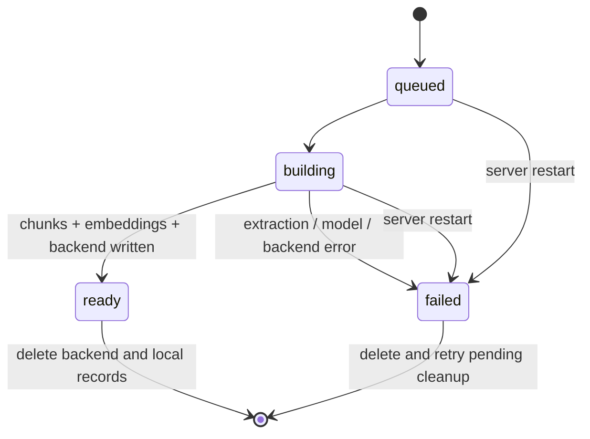

# Architecture and design decisions

## Small, explicit components

| File | Responsibility |
| --- | --- |
| `knowledge_lab/api.py` | Validated HTTP interface, NDJSON streaming, source delivery |
| `knowledge_lab/models.py` | Index, retrieval, chat and evaluation configuration contracts |
| `knowledge_lab/repository.py` | SQLite sources, metadata, chunk vectors, runs, conversations, recovery |
| `knowledge_lab/ingestion.py` | Text extraction and offset-preserving chunking |
| `knowledge_lab/embeddings.py` | Hash, Ollama and OpenAI-compatible embedding dispatch |
| `knowledge_lab/openai_compatible.py` | Bearer-authenticated chat/embedding requests, SSE parsing, safe errors |
| `knowledge_lab/stores/__init__.py` | Five interchangeable vector adapters |
| `knowledge_lab/retrieval.py` | BM25, vector retrieval, RRF, MMR, expansion and reranking |
| `knowledge_lab/generation.py` | Evidence packaging, prompt, provider dispatch, citation validation |
| `knowledge_lab/service.py` | Index lifecycle, experiment persistence and single-worker jobs |
| `evaluation/runner.py` | Fixed-corpus validation, metrics and report generation |
| `ui.py` | Streamlit client for the same API a future Flutter app could call |

The core pipeline is plain Python to make each step inspectable. The optional LangChain
integration is limited to a recursive splitter. Adding a framework to the entire chain would
make it harder to isolate retrieval differences at this stage.

## Index lifecycle

Each build gets a UUID namespace. The canonical SQLite chunk table keeps normalized vectors as
well as passages, even when another backend stores a second copy. This costs space, but lets MMR
use the identical indexed vectors and preserves the exact experiment inputs. Optional database
queries execute against their selected backend; the app never silently falls back to SQLite.

Only `ready` indexes can be queried. Embedding identity includes hash algorithm/dimensions or an
Ollama model digest. Ollama identity is checked before/after builds and before vector queries.
BM25 can still run when Ollama is unavailable because it does not need query embeddings.

API embeddings use an identity built from an endpoint hash, model name, and explicit revision
label. The configured model is frozen into the index. Endpoint or revision changes invalidate
vector queries; rotating only the key does not. Provider model aliases lack a standard weight
digest, so pin versions and manually increment the revision for known embedding-model changes.
The adapter validates returned embedding indices before restoring input order and normalizing
vectors. No SDK or provider model-discovery request is needed.

Index builds and evaluations use one background thread. The service lock serializes work that
reads or changes snapshots. API status reads do not acquire that lock. Run only one ASGI worker;
multiple processes would not share this lock or job ownership. A future multi-user service would
need a durable job queue, per-index locks, and transactional cross-service cleanup.

Streaming generation holds no lock across a yielded event or model request. A synchronous ASGI
stream may resume on a different worker thread, so carrying a thread-owned lock across events
would be incorrect. The final save checks that the index and conversation still exist and that
the conversation revision is unchanged. Run and conversation writes share one SQLite transaction.
Deletion or a competing turn therefore causes an explicit stream error instead of resurrecting
deleted evidence or overwriting a newer conversation.

## Retrieval details

- BM25 uses case-folded Unicode words, an explicit stopword list, k1=1.5 and b=0.75.
- Hash embeddings use SHA-256 feature hashing with signed term counts and L2 normalization.
  They intentionally make a zero-model baseline, with no claim of language understanding.
- Dense adapters return cosine similarity (FAISS uses inner product on normalized vectors).
- Hybrid retrieval combines **ranks**, not raw BM25 and cosine scores: each list contributes
  its weight divided by `(60 + rank)`. The UI exposes the vector weight.
- MMR greedily balances cosine relevance and similarity to already-selected passages.
- Lexical reranking sorts selected candidates by query-word coverage. It is not a cross-encoder.
- Query expansion is a deterministic dictionary for common remittance terms. Its output is
  visible and saved. It is not multi-query LLM generation or HyDE.
- Source filters apply before BM25 scoring. Dense filtering requests all index candidates and
  then filters before selecting top k, preventing a tiny candidate pool from hiding matching
  documents. That strategy is deliberately costly and suitable only for these small corpora;
  approximate backends may still return fewer candidates than requested.

BM25 scores and fused ranks are not calibrated confidence scores. A cosine threshold is also
not a reliable semantic answerability test. “No results” can trigger abstention; nonempty results
do not establish that an answer exists.

## Generation and evidence

Retrieval happens before generation. The app sends only the included source passages, their
labels, the current question and up to two preceding user questions. It does not treat prior
assistant text as fresh evidence. The prompt prohibits following document instructions and
requires unsupported questions to receive a fixed abstention sentence.

Context truncation preserves exact source offsets. The output uses `[S1]`, `[S2]`, etc. The
mechanical validator rejects unknown labels and uncited paragraphs. It cannot check negation,
causality, completeness, or whether the chosen passage actually supports a statement. The UI
therefore provides source inspection and a human review form, not a “verified truth” badge.

Time to first token is measured from the start of the chat operation and includes retrieval and
model inspection. Total time, token counts when returned, model digest, prompt version, request
settings, source passages, draft and final answer are saved locally. No external tracing is used.
Interrupted/error streams have no completed run. A completed but citation-rejected run retains
its draft for review.

OpenAI-compatible chat uses SSE at `/chat/completions` and adapts text deltas/usage into the same
internal events as Ollama. A terminal `stop` or `length` finish reason is required; disconnected,
filtered, or tool-call responses are not saved as successful answers. Truncation is handled by
the existing answer validation path. Credentials are server settings only and excluded from
serialized settings and run records. HTTP redirects and automatic retries are disabled. Error
messages report safe status-specific guidance rather than provider response bodies.

The selected API may be remote. Upload and storage remain local, while explicit API indexing
sends chunks, vector queries send query text, and API chat sends questions plus retrieved evidence.
Startup and health checks never call inference providers.

## Data and deletion

`data/lab.sqlite3` contains original source bytes, extracted pages, canonical chunks/vectors, index
metadata, runs and conversations. `data/chroma` and `data/faiss` hold their backend artifacts;
PostgreSQL and Qdrant keep their own data. UUID-only backend namespaces prevent user-provided
names from becoming SQL identifiers, collection names or filesystem paths.

Content hashes deduplicate exact uploads. Uploading changed contents creates a new document,
even when the filename is the same. Rebuild creates a new snapshot; it does not overwrite a
previous experiment. To compare document versions, select the intended source IDs explicitly.

Deleting a document invalidates whole affected snapshots and removes their saved evidence runs.
If several indexes are affected, deletion can make partial progress before an unreachable backend
stops it; the source remains until cleanup succeeds. Retry when that backend is available.
Crash recovery marks builds that reached the storing stage for backend cleanup.

## Primary implementation references

- [OpenAI Chat Completions](https://developers.openai.com/api/reference/resources/chat):
  streaming chunks, finish reasons and usage fields.
- [OpenAI embeddings](https://developers.openai.com/api/reference/resources/embeddings/methods/create):
  explicit float vectors and input-index mapping.

- [Ollama embedding API](https://docs.ollama.com/api/embed): explicit vectors and disabled truncation.
- [Ollama chat API](https://docs.ollama.com/api/chat): streamed chat and usage fields.
- [Ollama model listing](https://docs.ollama.com/api/tags): installed model names and digests.
- [pgvector](https://github.com/pgvector/pgvector): cosine operator, exact search and HNSW.
- [Chroma explicit embeddings](https://docs.trychroma.com/docs/collections/add-data) and
  [collection configuration](https://docs.trychroma.com/docs/collections/configure).
- [Qdrant local setup](https://qdrant.tech/documentation/quickstart/).
- [FAISS getting started](https://github.com/facebookresearch/faiss/wiki/Getting-started).

These references informed the adapter implementations. They do not substitute for the pending
live integration tests against the selected package/service versions.
