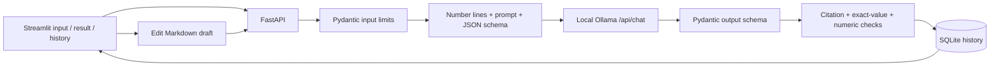

# Support Transcript Summarizer

Turn a fictional support conversation into an editable handover with evidence links.
This is project 1 from [the AI project roadmap](../AI_PROJECT_ROADMAP.md).

The app uses **Python, FastAPI, Pydantic, Ollama, SQLite and Streamlit**. It runs locally;
there are no paid API calls, agents, vector databases, or automatic follow-up messages.
Streamlit keeps the first interface in Python so the model request and validation flow
are easy to inspect. A future Flutter client can use the same API.

## What it does

- Paste a transcript or upload a UTF-8 `.txt` file.
- Generate the customer issue, exact names/amounts/references/dates, other facts,
  completed actions, conflicting statements, open questions, and proposed next steps.
- Represent missing or unresolved details as `null`, displayed as **Unknown / not established**.
- Inspect the numbered transcript lines behind each factual field or claim.
- Edit a Markdown handover while retaining the original structured response.
- Save, reopen, export, and delete conversations in local SQLite history.
- Show measured latency and provider token counts, when available.

This is a single-user portfolio application for synthetic data. It has no authentication,
encryption at rest, or multi-user access controls. Bind the services to loopback as below.
Review the output: valid JSON and valid citations do **not** prove that a claim is supported.

Current verification: **49 automated tests pass**. Live testing with `qwen2.5:0.5b`
found unreliable extraction; none of the 20 cases passed all expected checks. The
configured `qwen2.5:3b` model has not been tested. Model setup and the successful demo
recording are left for later; see [the dated verification report](reports/VERIFICATION-2026-09-28.md).

## Run locally

Prerequisites: Python 3.11+, [uv](https://docs.astral.sh/uv/getting-started/installation/),
and [Ollama](https://ollama.com/download). The project includes a complete `uv.lock` with
resolved versions and package hashes. Run commands from this directory.

```bash
uv sync --frozen
cp .env.example .env
```

Start Ollama in one terminal (skip this if the Ollama app is already running):

```bash
ollama serve
```

Start the app:

```bash
uv run --frozen python scripts/dev.py
```

The interface opens without a model and shows its unavailable status. Starting the app
does not download models. When you are ready, download the configured model yourself:

```bash
ollama pull qwen2.5:3b
```

Open **http://127.0.0.1:8501**. API documentation is at **http://127.0.0.1:8010/docs**.
Press Ctrl-C in the launcher terminal to stop its child processes. An independently started
Ollama service remains running. First generation includes model-loading time.

`OLLAMA_MODEL` in `.env` selects the model. `qwen2.5:3b` is a compact default for a 16 GB
Apple silicon machine. `qwen2.5:0.5b` is a smaller baseline useful for exercising the full
flow on a slow connection; it failed the expected checks in this project's live evaluation. Model
tags can change; live reports record the model digest as well as the tag. See the
[model page and license](https://ollama.com/library/qwen2.5:3b) before using model weights
outside this personal demo.

If this workspace has a project-local `.runtime/ollama` installation, `scripts/dev.py`
starts it automatically when no local Ollama server is running. Its model directory is
`.runtime/models`, which is excluded from version control. To pull another model into it:

```bash
OLLAMA_MODELS="$PWD/.runtime/models" .runtime/ollama/ollama pull qwen2.5:3b
```

The `.runtime` directory is a local convenience, not a portable dependency. Other machines
should install Ollama normally. `.env` is ignored; `.env.example` contains no secrets.

### Start the services separately

```bash
uv run --frozen uvicorn summarizer.api:app --host 127.0.0.1 --port 8010
uv run --frozen streamlit run ui.py
```

Run each command in a separate terminal. `API_BASE_URL`, `OLLAMA_BASE_URL`,
`OLLAMA_MODEL`, `MODEL_TIMEOUT_SECONDS`, and `DATABASE_PATH` can be configured in `.env`.

### Start with just one model call

```bash
uv run --frozen python scripts/summarize.py examples/delayed_transfer.txt
```

This skips the API, interface, and database. Inspect the returned JSON and cited lines first.

## Architecture



`summarizer/provider.py` makes one direct HTTP request to Ollama. The JSON schema is
provided in the `format` parameter. Two worked examples in the prompt demonstrate
citations and explicit unknown values. Temperature is zero, seed is 42,
the context window is 16,384 tokens and the output limit is 2,400 tokens. These settings
reduce variation; they do not make output correct or perfectly reproducible across versions.

Input is normalized to LF line endings and trimmed at its outer edges. Internal blank
lines remain, so citations refer to the physical lines displayed in the result. The
stored transcript is this normalized version.

Validation checks:

1. Required keys, types, bounded lists, and explicit unknown values.
2. At least one source line for every non-null extracted value and factual claim.
3. Source lines exist, are nonempty, and are not repeated within a claim.
4. Extracted names, amounts, references, dates and delay reasons are exact quoted spans.
5. Numbers and alphanumeric references in factual claims occur in the cited lines.

Semantic support, speaker attribution, negation, contradictions, and completeness still
need review. For example, a model could cite “not received” while writing “received” and
pass these mechanical checks. Proposed steps and questions are also model-generated and
are displayed separately. Transcript instructions are treated as untrusted data in the
prompt; this is a mitigation, not a guarantee against prompt injection.

Edits are saved separately as a **human-edited draft** with a revision number. The
original structured response remains unchanged. Concurrent stale edits receive HTTP 409.
Edits are deliberately not advertised as model-validated. Export includes the saved draft,
its review label, and the numbered source transcript.

## API example

```bash
curl -sS http://127.0.0.1:8010/api/summaries \
  -H 'Content-Type: application/json' \
  -d '{"title":"Missing transfer","transcript":"Customer: My QAR 100 transfer TX-01 is missing.\nAgent: I checked TX-01; it is pending."}'
```

| Method | Endpoint | Purpose |
| --- | --- | --- |
| GET | `/health` | API status and separate model readiness |
| POST | `/api/summaries` | JSON `{title, transcript}` → saved handover |
| POST | `/api/summaries/upload` | Multipart `.txt` file and optional title |
| GET | `/api/summaries?limit=20&offset=0` | Paginated history |
| GET | `/api/summaries/{id}` | Saved transcript, summary, draft, metrics |
| PATCH | `/api/summaries/{id}` | `{draft_markdown, revision}` |
| GET | `/api/summaries/{id}/export` | Download the saved Markdown handover |
| DELETE | `/api/summaries/{id}` | Delete one handover and its transcript |

```bash
curl -sS http://127.0.0.1:8010/api/summaries/upload \
  -F 'file=@examples/incomplete_conversation.txt' -F 'title=Missing details'
```

Input limits: **6,000 characters, 8,000 UTF-8 bytes, 80 lines**; upload file limit 24,000
bytes; total HTTP request body limit 64 KiB. The conservative UTF-8 byte limit leaves room
for instructions, line labels, schema and output within the configured context. Different
models/tokenizers still need evaluation. Long-document summarization is outside this version.

| Failure | Behavior |
| --- | --- |
| Empty, malformed, overlong text | 422 with field messages; no model call |
| Oversized upload / HTTP body | 413 |
| Wrong file extension / invalid UTF-8 | 415 |
| Missing model / unavailable Ollama | 503 with startup guidance |
| Model timeout | 504 |
| Invalid, truncated or mechanically unsupported model output | 502; no successful record saved |
| Missing handover | 404 |
| Stale edit | 409; reopen before saving |
| Database unavailable | 503 |

There is no automatic generation retry: a failure remains visible and a retry is explicit.
Repeated successful submissions create separate history entries. If the UI request times
out, check history before retrying. `/health` returning 200 means the API is alive; inspect
`model_status.available` to determine whether the selected model is downloaded and reachable.

## Tests and live evaluation

```bash
uv run --frozen pytest -q
uv run --frozen ruff check .
uv run --frozen ruff format --check .
uv run --frozen python -m evaluation.run
```

Automated tests use explicit test doubles and mocked HTTP responses. They check the real
adapter contract, API errors, persistence, deletion, editing, validation, and Streamlit
widget interactions. Test doubles are never selectable as the production model.

Live evaluation calls the configured Ollama model for all **20 independently authored
synthetic conversations** in `evaluation/cases.json`. Each has hand-written expected
values and review notes. It records actual output, latency, tokens where available, model
digest, prompt version and dataset hash in dated JSON and Markdown files under `reports/`.

```bash
# A quick smoke evaluation; still makes actual model calls
uv run --frozen python -m evaluation.run --limit 2

# Compare another locally installed model without changing the code
OLLAMA_MODEL=qwen2.5:0.5b uv run --frozen python -m evaluation.run
```

The evaluator exits 1 when an expected check fails, while still writing the results.
Exact values and keyword checks are useful regression signals, not accuracy measurements.
The set is a development baseline, not a held-out benchmark. Review each claim and each
citation using [the review rubric](docs/EVALUATION.md); record semantic failures separately.
Do not describe a mocked integration test as a successful live model run.

## Docker option

Keep Ollama on the host to use Apple silicon acceleration. With Docker running:

```bash
docker compose up --build
```

The API reaches the host via `http://host.docker.internal:11434`; history uses the named
`history` volume. Only loopback ports 8010 and 8501 are published. On hosts where Docker
cannot reach a loopback-bound Ollama service, configure Ollama to listen on an interface
reachable by Docker (commonly `OLLAMA_HOST=0.0.0.0:11434`) and restrict access with your host
firewall. Host-network behavior differs between Docker Desktop and Linux; the local
non-container setup is the primary development path.

`docker compose down` keeps history. `docker compose down -v` deletes the demo volume.
The container definition is included for reproducibility; consult the results report for
which runtime paths were actually exercised in this workspace.

## Demo and learning

- [Three-minute demo script](docs/DEMO.md)
- [Concepts, interview notes, and a small extension exercise](docs/LEARNING.md)
- [Evaluation rubric](docs/EVALUATION.md)
- [Actual verification and live evaluation reports](reports/)

To capture a terminal demo against the running API:

```bash
uv run --frozen python scripts/record_demo.py
```

It records actual API results into an asciicast `.cast` file plus a plain-text transcript,
then removes only the temporary demo records it created. Play the `.cast` with asciinema.

## Boundaries and data

Synthetic examples are included; personal CV files are not inputs to this application.
History is plain local SQLite. Deletion removes the row with SQLite secure deletion enabled;
it cannot erase exported files, filesystem snapshots, backups, or previously copied data.
The app does not log transcript content or expose raw provider error bodies.

No OpenAI adapter is implemented because this project uses the selected local Ollama path.
It does not establish experience with OpenAI APIs, RAG, model training, or agents. Audio,
PDFs, long conversations, multi-user deployment and sending messages are outside this version.

Primary implementation references: [Ollama structured output](https://docs.ollama.com/capabilities/structured-outputs),
[Ollama chat API](https://docs.ollama.com/api/chat),
[FastAPI lifespan testing](https://fastapi.tiangolo.com/advanced/testing-events/), and
[Streamlit API reference](https://docs.streamlit.io/develop/api-reference).
